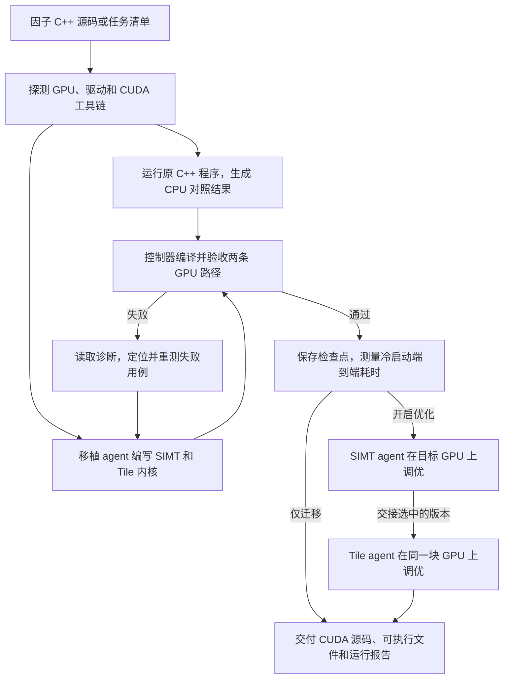
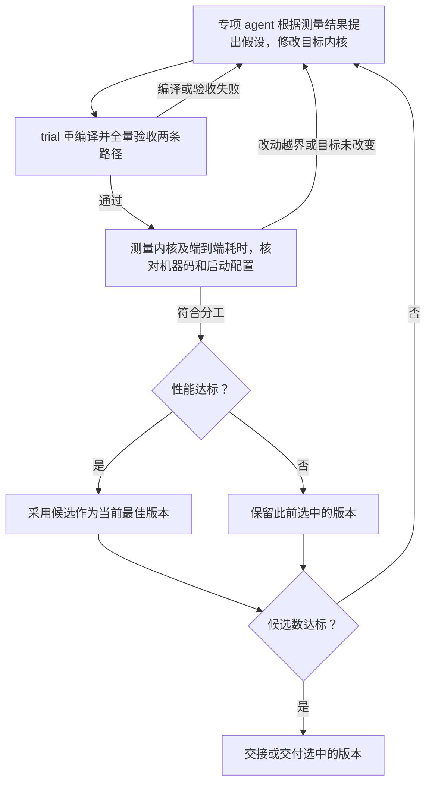

# FactorPort

FactorPort 用 agent 工作流把量化因子的 C++ 参考实现迁移到 CUDA，并针对目标 GPU 分别优化 SIMT 和共享内存 Tile 内核。你提供因子源码和可复现的输入，原 C++ 程序提供计算真值。每次运行交付 CUDA 源码、可执行文件、正确性报告和端到端耗时。

`OrderFillRateSpread.cpp` 是一个完整的高频因子示例。其他因子可以使用自己的输入格式、窗口、预热规则和输出列。[订单成交率差示例](examples/order-fill-rate-spread/README.md) · [通用窗口算子样例](examples/window_energy/task.json)

## Agent 工作流

模型通过配置的 API 选择工具，控制器在计算节点执行工具并返回观测结果。Agent 可以按需查阅离线 CUDA 手册或编译小实验。下图展示从因子源码开始的迁移路径。



已有 CUDA 候选可通过 `--candidate` 送验，通过后作为优化起点。两个专项 agent 各自运行下方的[候选选版循环](#候选选版循环)。

## 快速开始

在 Linux CUDA 节点准备 Python 3.10+、C++17 编译器、兼容的 CUDA Toolkit、CUPTI 和 Compute Sanitizer。专项优化还使用 Nsight Systems 的 CUDA trace 和 SQLite 导出。工具隔离需要 Linux 用户、挂载、PID 和网络命名空间，以及 `unshare` 和 `ip`。仓库的 `workflow/cuda.sh` 已包含 计算节点 的解释器、Toolkit 和 GPU 配置。

```sh
git clone git@github.com:delta-1234/cpp2cuda.git
cd cpp2cuda
bash workflow/cuda.sh --configure-api
bash workflow/cuda.sh --check-api

# 用仓库自带的通用用例跑通迁移、正确性验证和两个专项优化 agent
bash workflow/cuda.sh --agent --spec examples/window_energy/task.json \
  --optimize --profile-case many
```

在其他节点，可在配置好模型 API 和本地 CUDA 工具链后直接运行 Python 入口。`CUDA_VISIBLE_DEVICES` 指定获分配的 GPU，`CUDA_HOME` 和 `NVCC_CCBIN` 可指定 Toolkit 和兼容的主机编译器。

```sh
python3 workflow/port_agent.py --spec examples/window_energy/task.json --optimize --profile-case many
```

单文件因子也可用简写 `bash workflow/cuda.sh --generate-cuda path/to/factor.cpp` 一次完成迁移和优化。

如需先独立盘点环境，可运行 `bash workflow/cuda.sh --agent --inspect --task "检查已分配 GPU 和工具链"`。

## 接入自己的因子

**单文件程序**可以直接传给 `--source`。例如，一个从标准输出返回结果、接受一个行情文件路径的因子，可以按下面的方式运行。`--input` 中的路径相对于源文件目录。没有现成用例时，模型也可以阅读源码并提出小型测试。

```sh
bash workflow/cuda.sh --agent --source factors/Momentum.cpp \
  --input fixtures/prices.csv --optimize
```

**多文件程序或自定义回放**使用任务清单。下面的例子假设因子的 CPU 命令为 `momentum INPUT.csv OUTPUT.csv`，行情列和计算规则由这个程序定义。把清单保存在因子目录，再运行 `bash workflow/cuda.sh --agent --spec factors/momentum/task.json --optimize --profile-case trading_day`。

```json
{
  "source": "main.cpp",
  "units": ["momentum.cpp"],
  "headers": ["momentum.hpp"],
  "fixtures": ["data/warmup.csv", "data/day.csv"],
  "cases": [
    {"name": "warmup", "args": ["data/warmup.csv", "{output}"]},
    {"name": "trading_day", "args": ["data/day.csv", "{output}"]}
  ]
}
```

- `source` 是带 `main` 的 C++17 入口，`units` 列出其他编译单元。对依赖行情框架回调的类，可提供一个最小 CPU 回放入口，重现事件到达顺序和状态更新。
- 源码、头文件和测试数据位于任务目录内，路径相对于清单。CPU 输出需可复现。控制器逐字节比较标准输出，或比较 `{output}` 指定的文件。浮点文本的舍入、行序和缺失值表示也在比较范围内。
- 用例可覆盖该因子特有的边界，例如短窗口、多证券交错或交易日切换。`--profile-case` 选取能代表实际负载且会启动 GPU 内核的用例。除订单示例外，通常使用默认的 `stdio` 配置。

## Agent 如何迁移和优化

| 阶段 | 模型与控制器的分工 |
| --- | --- |
| 探测与分析 | Agent 调用工具检查实际 GPU、计算能力、warp 大小、SM 数、寄存器、共享内存和已安装的编译器。它可以检索离线 CUDA 手册或编译小实验，确认方案适用于当前硬件。 |
| 生成与验收 | 移植 agent 阅读参考实现，选择并行边界，生成 SIMT 和 Tile 两条路径。控制器编译源码，用独立 CPU 结果逐例比对，使用 CUPTI 核对实际内核启动，用 Compute Sanitizer 检查显存访问。 |
| 专项优化 | 开启 `--optimize` 后，SIMT agent 针对线程映射、访存合并、warp 归约和寄存器压力提出改动。Tile agent 针对分块形状、共享内存复用、bank conflict、同步和尾块提出改动。两者使用独立对话并依次测试，共享同一块 GPU 和当前已选源码。 |
| 测量与选择 | 每次 `trial` 记录硬件假设，重新编译、验证并测速。Nsight 分别采样三次，取进程内所有内核执行时间之和的中位数。另以无 profiler 的冷启动进程轮换测量 CPU、SIMT 和 Tile 的端到端中位数，包括 I/O、初始化及数据传输。 |

### 候选选版循环



控制器用 `cuobjdump` 对比 CUPTI 实际记录的内核入口机器码，并核对代表性输入的启动次数、线程块形状及共享内存用量。每个角色提交的版本须改变自己负责的内核或启动配置，并保留另一条路径的这些属性。默认保留标准为目标内核时间至少下降 3%，同时另一条内核以及各基准用例上两条 GPU 路径的端到端退化均不超过 5%。耗时没有改善时保留已验证的起点。每个角色默认实测两种不同候选后交接，最多 12 轮模型决策。深度搜索可用 `--specialist-trials 3 --specialist-steps 24` 比较三种候选。

编译或比对失败后，agent 可以读取日志、定位首个差异、定向重测并修复。源码改动会使先前的验收失效。已验证的源码保存在检查点中。如果专项 agent 耗尽轮数仍未测足有效候选，控制器保留已选版本，在报告中标记优化未完成。[修复与回退机制](offline_docs/agent-repair.md) · [操作约定](AGENTS.md)

## 模型 API、后端和离线资料

仓库根目录的 `.env` 保存模型连接配置。交互式配置会隐藏密钥并设置 0600 权限。Git 忽略本地环境文件，仓库提供空密钥模板。[配置模板](.env.example)

| 设置 | 用途 |
| --- | --- |
| `OPENAI_BASE_URL` | 模型服务的基础地址，含服务商要求的版本路径 |
| `OPENAI_MODEL` | 服务提供的模型 ID |
| `OPENAI_API_KEY` | Bearer 密钥，支持免密内网服务 |
| `FACTOR_API_PROTOCOL` | `chat`（默认）或 `responses` |

同名环境变量优先。可用 `FACTOR_API_CONFIG` 显式指定 dotenv 或 JSON 文件。其余情况下依次查找仓库 `.env`、`~/.config/order-fill-rate-cuda/api.json` 和 `~/.env`。外层控制器访问配置的模型端点，工具执行和 CUDA 文档检索均在本地完成。源文件和工具观测会按需发送给模型，预先准备的官方手册放在 `offline_docs/nvidia/`。[离线知识库](offline_docs/README.md)

`--backend builtin` 使用内置工具循环。`--backend transformers` 接入开源 Hugging Face `ReactJsonAgent`，复用同一组受控工具、API 配置和验收规则。计算节点 已预装兼容的 Transformers 4.41.2，可使用以下命令。

```sh
WORKFLOW_PYTHON="$(command -v python3)" \
  bash workflow/cuda.sh --agent --spec examples/window_energy/task.json \
  --optimize --profile-case many --backend transformers
```

## 运行结果

每次运行会打印独立的 `runs/cuda-agent-*/` 目录。查看 `candidate/port/` 获取选中的 CUDA 源码。`candidate/runs/replay` 可用 `simt` 或 `tile` 加原 CPU 命令的参数运行。

| 文件 | 可以核对什么 |
| --- | --- |
| `report.json` | GPU 与工具链、CPU 比对、显存检查、端到端耗时。启用优化时，`optimization` 还记录起点、两个 agent 的试验和最终选版。 |
| `tools.jsonl`、分步日志 | 模型调用了哪个工具，得到了什么观测，哪一步出现了差异。 |
| `checkpoints/` | 通过全量验收的候选源码和对应版本。可通过 `--candidate 上次运行的/candidate/port` 继续优化。 |

`verified` 表示所选代码通过正确性验收并完成计时。是否值得部署，要看目标工作负载的端到端结果。仓库包含通用窗口算子的迁移与故障修复记录，以及订单示例的交易数据格式、预热语义、流式回放和不同规模的 GPU/CPU 实测结果。[通用迁移记录](validation/port-agent-rtx3090.json) · [纠错记录](validation/agent-repair-rtx3090.json) · [双 agent 硬件优化实测](validation/factorport-specialists-rtx3090.json) · [订单因子示例与基准](examples/order-fill-rate-spread/README.md)
