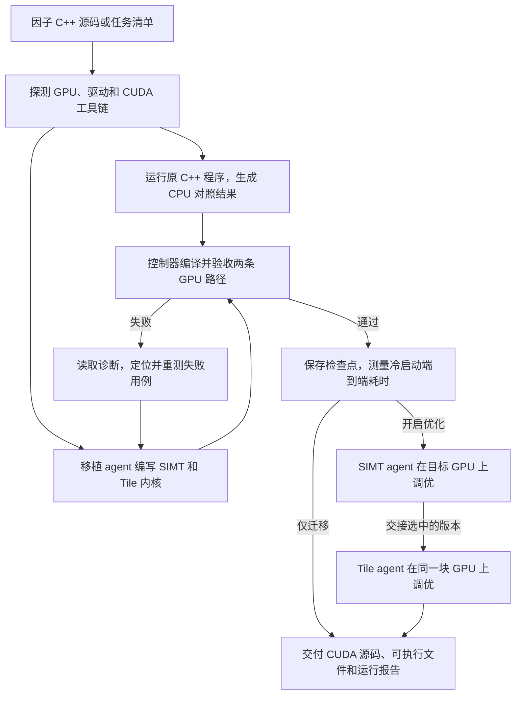
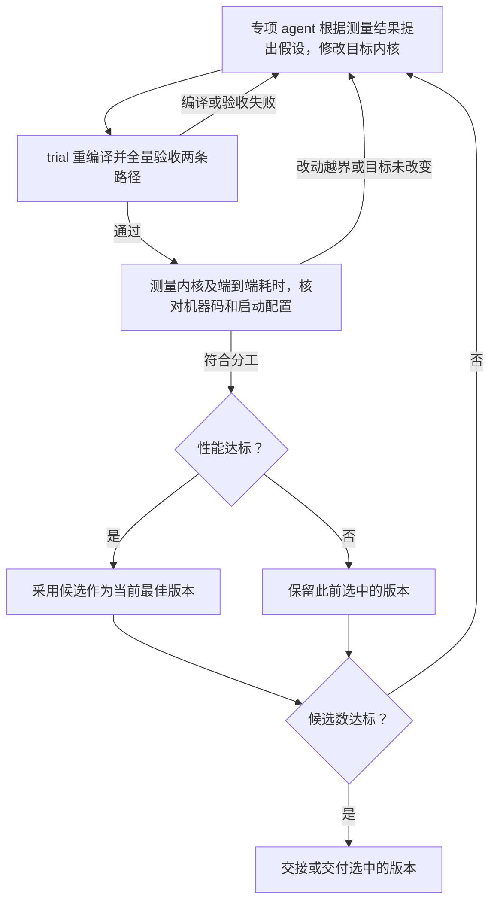

# FactorPort

**FactorPort 支持离线编写、验证和优化量化因子的 CUDA 代码。** 仓库自带可检索的 NVIDIA CUDA 编程指南和最佳实践手册。Agent 可以直接查阅本地手册和已安装的 Toolkit 头文件，无需联网搜索或访问外部文档。预先装好依赖并将模型 API 指向本机的兼容推理服务后，整个工作流可在断网节点上运行。选用远程模型时，节点需要能访问配置的模型端点。[离线知识库](offline_docs/README.md) · [模型 API 配置](#模型-api-配置)

你提供因子的 C++ 源码和可复现的输入。Agent 探测目标 GPU，编写 SIMT 和共享内存 Tile 两种实现。启用专项优化后，两条路径分别调优。控制器在节点上编译运行，以原 C++ 程序的输出校验结果，保存 CUDA 源码、可执行文件、正确性报告和端到端耗时。

`OrderFillRateSpread.cpp` 是一个完整的高频因子示例。其他因子可以使用自己的输入格式、窗口、预热规则和输出列。[订单成交率差示例](example/order-fill-rate-spread/README.md) · [截面动量排名示例](example/momentum_rank/README.md) · [通用窗口算子样例](example/window_energy/task.json)

[快速开始](#快速开始) · [示例加速结果](#示例加速结果) · [选择 Agent 后端](#选择-agent-后端) · [模型 API 配置](#模型-api-配置) · [许可证](#许可证)

## 示例加速结果

截面动量排名因子 `MomentumRank` 由 **Pi 1.6.0** 通过已配置的模型 API 调用 **`qwen3.8-max`**，从 C++ 生成并修复了 SIMT 和共享内存 Tile 两种 CUDA 实现。单线程 CPU 基线使用 **Intel Xeon Gold 6248R** 的逻辑核 6，GPU 使用 **NVIDIA GeForce RTX 3090**（sm_86），CUDA Toolkit 为 **11.3**。[迁移与修复记录](example/momentum_rank/validation/pi-rtx3090.json)

下表给出预热后 11 次测量的中位数。加速比为单线程 CPU 计算时间除以 GPU 完成同一因子的全部内核时间，覆盖交易日分组、收益率和排名。计时排除 CSV 读写、CUDA 初始化和主机与显卡之间的传输。

| 模拟输入 | 行数 | CPU（µs） | SIMT（µs） | Tile（µs） | SIMT 加速比 | Tile 加速比 |
| --- | ---: | ---: | ---: | ---: | ---: | ---: |
| 2 日 × 256 只 | 512 | 20.24 | 23.20 | 22.75 | 0.87× | 0.89× |
| 多日边界样例 | 866 | 41.85 | 31.94 | 31.52 | 1.31× | 1.33× |
| 4 日 × 256 只 | 1,024 | 52.18 | 24.00 | 23.84 | 2.17× | 2.19× |
| 7 日留出集 | 6,417 | 457.30 | 182.66 | 3,574.35 | 2.50× | 0.13× |
| 1,024 日 × 256 只 | 262,144 | 17,665.62 | 120.16 | 74.91 | 147.02× | 235.82× |

每天 256 只证券时，两条 GPU 路径在 512 行时都慢于 CPU，到 1,024 行时都已快于 CPU。留出集有一天包含 4,346 只有效证券，超过 Tile 共享内存排序的 4,096 项容量，转入分片比较后，Tile 在这组输入上慢于 CPU。

若从启动程序计时直到写完 CSV，866 行边界样例的三次冷启动中位数为 CPU **4.410 ms**、SIMT **149.911 ms**、Tile **146.687 ms**。这个规模下 CPU 最先完成整次任务。[完整 14 组结果、测试环境及复现命令](example/momentum_rank/README.md#测试环境与实测结果) · [纯计算原始计时](example/momentum_rank/validation/compute-rtx3090.json)

## 仓库结构

| 目录 | 内容 |
| --- | --- |
| `example/order-fill-rate-spread/` | 订单因子的 C++ 参考程序和头文件。`data/` 存放模拟逐笔行情和预期输出，`cuda/`、`stream/` 和 `generated/` 存放不同 GPU 实现，`validation/` 保存该因子的测量记录。 |
| `example/momentum_rank/` | 按交易日计算证券收益率的截面排名，包含 C++ 参考实现、模拟行情、Pi 生成的 CUDA 和 GPU 验证记录。 |
| `example/window_energy/` | 五点窗口算子的 C++ 源码、任务清单、纠错用例、Pi 生成的 CUDA 代码和验证报告。 |
| `workflow/` | Agent、构建和验证入口、离线工具及回归测试。 |
| `offline_docs/` | 可供 agent 离线检索的 CUDA 手册和工作流说明。 |
| `validation/` | 跨示例的迁移报告与节点环境记录。 |
| `runs/` | 本机生成的可执行文件、检查点和每次运行的报告，Git 忽略此目录。 |

## Agent 工作流

模型通过配置的 API 选择工具，控制器在计算节点执行工具并返回观测结果。Agent 可以按需查阅离线 CUDA 手册或编译小实验。下图展示从因子源码开始的迁移路径。



已有 CUDA 候选可通过 `--candidate` 送验，通过后作为优化起点。两个专项 agent 各自运行下方的[候选选版循环](#候选选版循环)。

## 快速开始

在 Linux CUDA 节点准备 Python 3.10+、C++17 编译器、兼容的 CUDA Toolkit、CUPTI 和 Compute Sanitizer。专项优化还使用 Nsight Systems 的 CUDA trace 和 SQLite 导出。工具隔离需要 Linux 用户、挂载、PID 和网络命名空间，以及 `unshare` 和 `ip`。通用入口为 `bash workflow/cuda.sh`。它默认使用当前环境的 `python3`，并尊重调度器设置的 `CUDA_VISIBLE_DEVICES`。

```sh
git clone git@github.com:delta-1234/cpp2cuda.git
cd cpp2cuda
bash workflow/cuda.sh --configure-api
bash workflow/cuda.sh --check-api

# 用仓库自带的通用用例跑通迁移、正确性验证和两个专项优化 agent
bash workflow/cuda.sh --agent --spec example/window_energy/task.json \
  --optimize --profile-case many
```

配置好模型 API 和本地 CUDA 工具链后，也可直接运行 Python 入口。`CUDA_VISIBLE_DEVICES` 指定获分配的 GPU，`CUDA_HOME` 和 `NVCC_CCBIN` 可指定 Toolkit 和兼容的主机编译器。

在同一份检出中，可用 `git config --local factorport.python /path/to/python` 保存解释器，或用 `git config --local factorport.visibleDevices 0` 保存该机的默认 GPU 选择。启动脚本优先使用显式环境变量。

独立安装的 Nsight Systems 可通过 `NSYS` 指定可执行文件。本项目的 RTX 3090 基准使用 CUDA 11.3 编译、Nsight Systems 2022.1.3 采样。如果一次导出没有 GPU 内核记录，控制器最多采集三次。报告记录每个有效样本的采集次数，连续三次空采样会使测量失败。

```sh
python3 workflow/port_agent.py --spec example/window_energy/task.json --optimize --profile-case many
```

单文件因子也可用简写 `bash workflow/cuda.sh --generate-cuda path/to/factor.cpp` 一次完成迁移和优化。

如需先独立盘点环境，可运行 `bash workflow/cuda.sh --agent --inspect --task "检查已分配 GPU 和工具链"`。

## 选择 Agent 后端

`--backend` 选择由谁管理模型对话和工具调用，默认值为 `builtin`。三个后端都使用配置的模型 API。迁移 agent、SIMT 优化 agent 和 Tile 优化 agent 共用本次选择，由同一个控制器编译、比对 CPU 结果并检查 GPU 内核启动。

| `--backend` | 工具调用方式 | 依赖与适用场景 |
| --- | --- | --- |
| `builtin`（默认） | Python 控制器解析模型返回的 JSON 动作或源码写入块。 | 无需额外的 agent 框架。首次迁移或使用仅支持文本生成的端点时可选。 |
| `transformers` | Hugging Face `ReactJsonAgent` 管理 ReAct 对话，通过 `cuda_tools` 分发模型返回的动作。 | 需要本地可导入 `transformers.agents.ReactJsonAgent` 的 Python 环境。已验证版本为 Transformers 4.41.2，模型推理通过配置的 API 执行。 |
| `pi` | Pi CLI 以 RPC 模式运行。模型通过原生函数调用请求当前角色可用的 `fp_*` 工具。 | 需要 Pi 可执行文件，以及支持流式函数调用和工具结果回传的模型端点。已验证版本为 Pi 1.6.0。 |

以下三条命令运行同一项窗口因子任务，任选一条。三者都生成 SIMT 和共享内存 Tile 两条 CUDA 路径，`--optimize` 再启用两个专项优化 agent。

```sh
# 内置后端，也可以省略 --backend builtin
bash workflow/cuda.sh --agent --spec example/window_energy/task.json --optimize --backend builtin

# Hugging Face ReAct，先激活安装了相应 Transformers 版本的 Python 环境
WORKFLOW_PYTHON="$(command -v python3)" \
  bash workflow/cuda.sh --agent --spec example/window_energy/task.json --optimize --backend transformers

# Pi 原生工具调用
bash workflow/cuda.sh --agent --spec example/window_energy/task.json --optimize --backend pi
```

### 哪些入口支持选择后端

| 入口 | 行为 |
| --- | --- |
| `--agent --source <程序.cpp>` 或 `--agent --spec <任务.json>` | 可任选三个后端。默认执行迁移、验证和测速，添加 `--optimize` 启用专项优化。 |
| `--agent --inspect --task '问题'` | 可任选三个后端。只分析节点环境，适合检查模型能否调用工具并返回实际 GPU 与编译器信息。 |
| `--generate-cuda <程序.cpp>` | 默认进入同一套可选后端的工作流并开启专项优化，`--no-optimize` 可关闭。 |
| `--agent '维护任务'` | 使用订单示例专用的 API 维护循环，后端固定。 |
| `--generate-cuda <程序.cpp> --per-file` 或 `--no-per-file` | 显式传入任一标志都会选择订单示例的旧版生成器，分别按文件或整组生成，后端固定。 |

其他 Linux 节点可用 `python3 workflow/port_agent.py --help` 查看同一通用入口的参数。Agent 后端由命令行选择，模型地址、模型 ID 和协议由 API 配置决定。[模型 API 配置](#模型-api-配置) · [Pi 离线部署](#pi-离线部署与检查)

### 运行生成的 CUDA 代码

已经完成迁移时，直接运行该次生成的可执行文件即可。第一个参数 `simt` 或 `tile` 选择 CUDA 实现，后续参数沿用原 CPU 程序的约定。例如，下面的命令用两种实现各计算 259 个窗口输出。

```sh
run=runs/cuda-agent-tb7q84yx  # 实测示例，换成自己的运行目录
"$run/candidate/runs/replay" simt 259 > "$run/simt.out"
"$run/candidate/runs/replay" tile 259 > "$run/tile.out"
cmp "$run/simt.out" "$run/tile.out"
```

订单示例另有流式回放入口 `--stream`，支持增量 CPU（`cpu`）、扫描 CPU（`legacy`）、CUDA（`simt`、`tile`）及预编译的 Triton（`triton`）。该示例的窗口打包验证器还会按本机依赖测试 Triton Tile 和 NVIDIA cuTile，`--require-cutile` 会将 cuTile 列为必验项。[订单示例的构建与回放命令](example/order-fill-rate-spread/README.md)

## 接入自己的因子

**单文件程序**可以直接传给 `--source`。例如，一个从标准输出返回结果、接受一个行情文件路径的因子，可以按下面的方式运行。`--input` 中的路径相对于源文件目录。没有现成用例时，模型也可以阅读源码并提出小型测试。

```sh
bash workflow/cuda.sh --agent --source factors/Momentum.cpp \
  --input fixtures/prices.csv --optimize
```

**多文件程序或自定义回放**使用任务清单。下面的例子假设因子的 CPU 命令为 `momentum INPUT.csv OUTPUT.csv`，行情列和计算规则由这个程序定义。把清单保存在因子目录，再运行 `bash workflow/cuda.sh --agent --spec factors/momentum/task.json --optimize --profile-case trading_day`。

```json
{
  "source": "main.cpp",
  "units": ["momentum.cpp"],
  "headers": ["momentum.hpp"],
  "fixtures": ["data/warmup.csv", "data/day.csv"],
  "cases": [
    {"name": "warmup", "args": ["data/warmup.csv", "{output}"]},
    {"name": "trading_day", "args": ["data/day.csv", "{output}"]}
  ]
}
```

- `source` 是带 `main` 的 C++17 入口，`units` 列出其他编译单元。对依赖行情框架回调的类，可提供一个最小 CPU 回放入口，重现事件到达顺序和状态更新。
- 源码、头文件和测试数据位于任务目录内，路径相对于清单。CPU 输出需可复现。控制器逐字节比较标准输出，或比较 `{output}` 指定的文件。浮点文本的舍入、行序和缺失值表示也在比较范围内。
- 用例可覆盖该因子特有的边界，例如短窗口、多证券交错或交易日切换。`--profile-case` 选取能代表实际负载且会启动 GPU 内核的用例。除订单示例外，通常使用默认的 `stdio` 配置。

## Agent 如何迁移和优化

| 阶段 | 模型与控制器的分工 |
| --- | --- |
| 探测与分析 | Agent 调用工具检查实际 GPU、计算能力、warp 大小、SM 数、寄存器、共享内存和已安装的编译器。它可以检索离线 CUDA 手册或编译小实验，确认方案适用于当前硬件。 |
| 生成与验收 | 移植 agent 阅读参考实现，选择并行边界，生成 SIMT 和 Tile 两条路径。控制器编译源码，用独立 CPU 结果逐例比对，使用 CUPTI 核对实际内核启动，用 Compute Sanitizer 检查显存访问。 |
| 专项优化 | 开启 `--optimize` 后，SIMT agent 针对线程映射、访存合并、warp 归约和寄存器压力提出改动。Tile agent 针对分块形状、共享内存复用、bank conflict、同步和尾块提出改动。两者使用独立对话并依次测试，共享同一块 GPU 和当前已选源码。 |
| 测量与选择 | 每次 `trial` 记录硬件假设，重新编译、验证并测速。Nsight 分别采样三次，取进程内所有内核执行时间之和的中位数。另以无 profiler 的冷启动进程轮换测量 CPU、SIMT 和 Tile 的端到端中位数，包括 I/O、初始化及数据传输。 |

### 候选选版循环



控制器用 `cuobjdump` 对比 CUPTI 实际记录的内核入口机器码，并核对代表性输入的启动次数、线程块形状及共享内存用量。每个角色提交的版本须改变自己负责的内核或启动配置，并保留另一条路径的这些属性。默认保留标准为目标内核时间至少下降 3%，同时另一条内核以及各基准用例上两条 GPU 路径的端到端退化均不超过 5%。耗时没有改善时保留已验证的起点。每个角色默认实测两种不同候选后交接，最多 12 轮模型决策。深度搜索可用 `--specialist-trials 3 --specialist-steps 24` 比较三种候选。

编译或比对失败后，agent 可以读取日志、定位首个差异、定向重测并修复。源码改动会使先前的验收失效。已验证的源码保存在检查点中。如果专项 agent 耗尽轮数仍未测足有效候选，控制器保留已选版本，在报告中标记优化未完成。[修复与回退机制](offline_docs/agent-repair.md) · [操作约定](AGENTS.md)

## 模型 API 配置

仓库根目录的 `.env` 保存模型连接配置。交互式配置会隐藏密钥并设置 0600 权限。Git 忽略本地环境文件，仓库提供空密钥模板。[配置模板](.env.example)

| 设置 | 用途 |
| --- | --- |
| `OPENAI_BASE_URL` | 模型服务的基础地址，含服务商要求的版本路径 |
| `OPENAI_MODEL` | 服务提供的模型 ID |
| `OPENAI_API_KEY` | Bearer 密钥，支持免密内网服务 |
| `FACTOR_API_PROTOCOL` | `chat`（默认）或 `responses` |

同名环境变量优先。可用 `FACTOR_API_CONFIG` 显式指定 dotenv 或 JSON 文件。其余情况下依次查找仓库 `.env`、`~/.config/order-fill-rate-cuda/api.json` 和 `~/.env`。外层控制器访问配置的模型端点，工具执行和 CUDA 文档检索均在本地完成。源文件和工具观测会按需发送给模型，预先准备的官方手册放在 `offline_docs/nvidia/`。[离线知识库](offline_docs/README.md)

三个后端均支持两种 API 协议。设置 `FACTOR_API_PROTOCOL=chat` 使用 `/chat/completions`，设置为 `responses` 使用 `/responses`。节点完全断网时，可将 `OPENAI_BASE_URL` 指向节点上已部署的兼容推理服务。使用远程模型时，节点需要能访问该端点。

### Pi 离线部署与检查

`bash workflow/cuda.sh --check-api` 会向配置的模型发送一次文本请求。要验证 Pi 的原生工具调用，可在同一节点运行下面的检查，核对报告中的 `backend`、`pi_version` 和 `actions`。

```sh
bash workflow/cuda.sh --agent --backend pi --inspect --task "报告 GPU 型号、计算能力和 nvcc 版本"
```

工作流以 RPC 模式启动独立的 Pi 进程，每个角色使用临时配置目录。Pi 通过 `fp_probe`、`fp_edit`、`fp_verify` 等原生函数调用现有控制器，工具出错时会把诊断和定向重测提示送回模型。启动时会核对实际模型和角色的工具清单。Pi 的内置 shell、文件工具、MCP 和扩展自动发现均已关闭。API 密钥通过 Pi 进程的环境变量传入，编译和运行候选代码沿用离线沙箱。原有的 `--max-steps` 与 `--specialist-steps` 分别控制迁移和专项优化的模型轮数。

本次测试使用官方 Pi 1.6.0 独立版。Linux x86-64 用户可在联网准备机下载同一归档，然后把归档和仓库一起传到计算节点。[Pi 1.6.0 官方发布页](https://github.com/earendil-works/pi/releases/tag/v1.6.0)

```sh
# 准备机
curl -fL -o pi-linux-x64.tar.gz \
  https://github.com/earendil-works/pi/releases/download/v1.6.0/pi-linux-x64.tar.gz

# 离线计算节点，在仓库根目录执行，归档路径按实际位置填写
archive=/path/to/pi-linux-x64.tar.gz
echo "ef77dbe4379b3bdeb425a1e1b862fa3c915c255000dfe4965c98eee96a5765d1  $archive" | sha256sum -c - && \
  mkdir -p runs/deps/pi-1.6.0 && tar -xzf "$archive" -C runs/deps/pi-1.6.0
```

也可用 `FACTORPORT_PI_BIN` 指定已有 Pi 可执行文件的绝对路径。其次查找仓库中的 `runs/deps/pi-1.6.0/pi/pi`，最后查找 `PATH` 中的 `pi`。Pi 启动时使用离线模式，CUDA 文档从仓库读取。可运行 `python3 workflow/test_pi_backend.py`，通过本地模拟的模型端点验证真实 Pi 的工具协议、纠错和轮数限制。

### Pi 在 RTX 3090 上的实测

Pi 1.6.0 使用配置的 `qwen3.8-max` 将五点窗口因子的 C++ 源码迁移到 RTX 3090。迁移阶段生成了 SIMT 和共享内存 Tile 两条路径。恢复运行时，控制器从已选检查点重新测量，两位专项 agent 各提交一个候选。最终源码通过了 1、259 和 8,193 个输出的 CPU 逐字节对照、CUPTI 内核启动检查和 Compute Sanitizer 显存检查。[选中的 CUDA 源码](example/window_energy/generated/window_energy_cuda.cu) · [测量与选版记录](example/window_energy/validation/pi-rtx3090.json)

| 专项 | 接手时内核耗时 | 候选内核耗时 | 选版结果 |
| --- | ---: | ---: | --- |
| SIMT | 5.280 µs | 2.784 µs | 采用。将依下标生成输入和窗口求和合为一次内核启动。 |
| Tile | 5.728 µs | 3.072 µs | 保留原 Tile。候选在 259 和 8,193 个输出上的 Tile 端到端中位数分别增加 8.2% 和 8.6%，超过 5% 门槛。 |

内核时间为 8,193 个输出上三次采样的中位数。恢复选中源码并重新编译后，该用例的冷启动端到端中位数为 CPU 3.589 ms、SIMT 220.432 ms、Tile 216.187 ms。这个规模下 CPU 更快。

## 运行结果

每次运行会打印独立的 `runs/cuda-agent-*/` 目录。查看 `candidate/port/` 获取选中的 CUDA 源码。`candidate/runs/replay` 可用 `simt` 或 `tile` 加原 CPU 命令的参数运行。

| 文件 | 可以核对什么 |
| --- | --- |
| `report.json` | GPU 与工具链、CPU 比对、显存检查、端到端耗时。启用优化时，`optimization` 还记录起点、两个 agent 的试验和最终选版。 |
| `tools.jsonl`、分步日志 | 模型调用了哪个工具，得到了什么观测，哪一步出现了差异。 |
| `checkpoints/` | 通过全量正确性验收的源码，每个版本一个目录。专项优化的选版结果记录在 `optimization.selected.checkpoint`。 |

专项优化中途停止后，可把已选检查点传给 `--candidate`。这会用所选后端开启新的会话，重新编译、验证并测量起点，再把实际测量交给两个专项 agent。若中断发生在首次性能选版之前，可从报告的 `last_verified_checkpoint` 恢复已通过正确性验收的源码。

```sh
run=runs/cuda-agent-ndsx1ldx  # 换成自己的运行目录
checkpoint=$(python3 -c 'import json,sys; r=json.load(open(sys.argv[1])); print(r.get("optimization", {}).get("selected", {}).get("checkpoint") or r["last_verified_checkpoint"])' "$run/report.json")
bash workflow/cuda.sh --agent --backend pi --spec example/window_energy/task.json \
  --candidate "$run/checkpoints/$checkpoint" --optimize --profile-case many
```

`verified` 表示所选代码通过正确性验收并完成计时。是否值得部署，要看目标工作负载的端到端结果。仓库包含通用窗口算子的迁移与故障修复记录，以及订单示例的交易数据格式、预热语义、流式回放和不同规模的 GPU/CPU 实测结果。[通用迁移记录](validation/port-agent-rtx3090.json) · [纠错记录](example/window_energy/validation/agent-repair-rtx3090.json) · [双 agent 硬件优化实测](example/order-fill-rate-spread/validation/factorport-specialists-rtx3090.json) · [订单因子示例与基准](example/order-fill-rate-spread/README.md)

## 验证安装

在仓库根目录运行以下命令。通用测试使用本地夹具，Pi 协议测试使用回环模拟端点。对应后端已经安装时，测试会实际启动其运行时。GPU 纠错回归在计算节点编译候选、运行 CPU 对照并验证检查点回退。

```sh
# 本地回归
python3 -m unittest discover -s workflow -p 'test_*.py'

# 已配置的模型端点连通性
bash workflow/cuda.sh --check-api

# 计算节点的真实 GPU 纠错回归
bash workflow/cuda.sh --test-repair
```

通用 agent 的报告以 `analyzed` 表示完成环境分析，`verified` 表示通过验证和测速，`verified_fallback` 表示恢复检查点后重新验收成功。遇到 `blocked` 时查看报告中的 `summary` 和缺失依赖。遇到 `failed` 时查看 `error` 和工具日志。

## 许可证

FactorPort 的原创代码和项目文档采用 **MIT License**（SPDX 标识符 `MIT`）。可以使用、修改、分发和商用。在分发软件副本或其实质性部分时，请保留版权声明和许可声明。[许可证全文](LICENSE)

`offline_docs/nvidia/` 中的 NVIDIA 手册 PDF 及其可检索文本遵循原文档的版权声明和许可条款。Pi、Transformers 和 CUDA Toolkit 等第三方软件也各自遵循上游许可证。用户提供的因子源码和数据沿用各自的授权。[NVIDIA 文档来源](offline_docs/sources.json)
