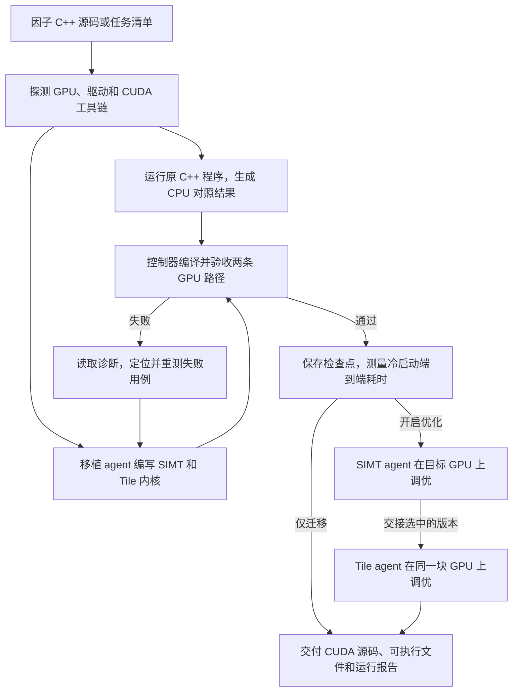
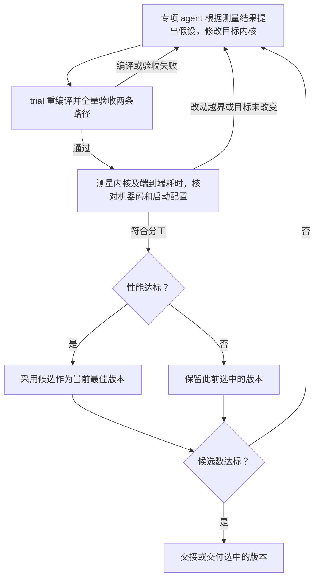

# FactorPort

**FactorPort 支持离线编写、验证和优化量化因子的 CUDA 代码。** 仓库自带可检索的 NVIDIA CUDA 编程指南和最佳实践手册。Agent 可以直接查阅本地手册和已安装的 Toolkit 头文件，无需联网搜索或访问外部文档。预先装好依赖并将模型 API 指向本机的兼容推理服务后，整个工作流可在断网节点上运行。选用远程模型时，节点需要能访问配置的模型端点。[离线知识库](offline_docs/README.md) · [模型 API 配置](#模型-api-配置)

你提供因子的 C++ 源码和可复现的输入。Agent 探测目标 GPU，编写 SIMT 和共享内存 Tile 两种实现。启用专项优化后，两条路径分别调优。控制器在节点上编译运行，以原 C++ 程序的输出校验结果，保存 CUDA 源码、可执行文件、正确性报告和端到端耗时。

[快速开始](#快速开始) · [配置模型 API](#模型-api-配置) · [选择 Agent 后端](#选择-agent-后端) · [接入自己的因子](#接入自己的因子) · [示例](#示例)

## 快速开始

在 Linux GPU 节点准备 Python 3.10+、C++17 编译器、CUDA Toolkit、CUPTI 和 Compute Sanitizer。工具隔离使用 Linux 的用户、挂载、PID 和网络命名空间，需要 `unshare` 和 `ip`。启用专项优化还需要支持 CUDA 采样和 SQLite 导出的 Nsight Systems。离线部署时，提前将仓库、所选后端及依赖放到节点上。

以下命令在仓库根目录执行。先配置模型服务并检查连通性，再用自带的窗口算子生成、编译和验证两种 CUDA 实现。

```sh
bash workflow/cuda.sh --configure-api
bash workflow/cuda.sh --check-api
bash workflow/cuda.sh --agent --spec example/window_energy/task.json
```

要让两个专项 agent 分别调优 SIMT 和 Tile，添加 `--optimize`。用 `--profile-case` 从任务清单中选择代表性输入。

```sh
bash workflow/cuda.sh --agent --spec example/window_energy/task.json --optimize --profile-case many
```

只需检查设备和工具链时，可运行 `bash workflow/cuda.sh --agent --inspect --task "检查 GPU 和 CUDA 工具链"`。入口默认使用当前环境的 `python3`，可用 `WORKFLOW_PYTHON` 指定解释器。`CUDA_VISIBLE_DEVICES` 选择可见 GPU，`CUDA_HOME`、`NVCC_CCBIN` 和 `NSYS` 分别指定 Toolkit、nvcc 主机编译器和分析器。也可通过 `git config --local factorport.python /path/to/python` 和 `git config --local factorport.visibleDevices 0` 为当前检出保存默认值，显式环境变量优先。

## 模型 API 配置

仓库根目录的 `.env` 保存模型连接配置。交互式配置会隐藏密钥并设置 0600 权限。Git 忽略本地环境文件，仓库提供空密钥模板。[配置模板](.env.example)

| 设置 | 用途 |
| --- | --- |
| `OPENAI_BASE_URL` | 模型服务的基础地址，含服务商要求的版本路径 |
| `OPENAI_MODEL` | 服务提供的模型 ID |
| `OPENAI_API_KEY` | Bearer 密钥，支持免密内网服务 |
| `FACTOR_API_PROTOCOL` | `chat`（默认）或 `responses` |

同名环境变量优先。可用 `FACTOR_API_CONFIG` 显式指定 dotenv 或 JSON 文件。其余情况下依次查找仓库 `.env`、`~/.config/order-fill-rate-cuda/api.json` 和 `~/.env`。外层控制器访问配置的模型端点，工具执行和 CUDA 文档检索均在本地完成。源文件和工具观测会按需发送给模型，预先准备的官方手册放在 `offline_docs/nvidia/`。[离线知识库](offline_docs/README.md)

三个后端均支持两种 API 协议。设置 `FACTOR_API_PROTOCOL=chat` 使用 `/chat/completions`，设置为 `responses` 使用 `/responses`。

## 选择 Agent 后端

通过 `--backend` 选择管理模型对话和工具调用的方式。迁移及两个专项优化 agent 使用同一个后端，模型由 API 配置指定。

| 后端 | 适用方式 | 运行所需 |
| --- | --- | --- |
| `builtin`（默认） | Python 控制器解析模型返回的工具动作或源码。 | 无需额外的 agent 框架，支持文本生成端点。 |
| `transformers` | Hugging Face ReAct agent 通过 `cuda_tools` 调用工作流工具。 | Python 环境中可导入 `transformers.agents.ReactJsonAgent`。 |
| `pi` | Pi 通过 RPC 管理会话，使用原生函数调用访问 `fp_*` 工具。 | 本地 Pi 可执行文件，以及支持流式函数调用和工具结果回传的模型端点。 |

使用 Pi 时，可将已准备好的可执行文件放在 `PATH`，或用 `FACTORPORT_PI_BIN` 指定其绝对路径。下面的命令会调用模型和探测工具，可用来检查后端是否接通。[Pi 离线安装示例](example/window_energy/README.md#离线准备本次使用的-pi-版本)

```sh
bash workflow/cuda.sh --agent --backend pi --inspect --task "检查已分配的 GPU"
```

`--agent --source`、`--agent --spec` 和 `--agent --inspect` 均可选择上述后端。`--generate-cuda <程序.cpp>` 默认同时执行迁移和专项优化，可加 `--no-optimize` 只做迁移与验收。订单示例的维护入口和 `--per-file` 等早期生成方式使用固定后端。[订单示例用法](example/order-fill-rate-spread/README.md)

## 接入自己的因子

**单文件程序**可以直接传给 `--source`。例如，一个从标准输出返回结果、接受一个行情文件路径的因子，可以按下面的方式运行。`--input` 中的路径相对于源文件目录。没有现成用例时，模型也可以阅读源码并提出小型测试。

```sh
bash workflow/cuda.sh --agent --source factors/Momentum.cpp \
  --input fixtures/prices.csv --optimize
```

**多文件程序或自定义回放**使用任务清单。下面的例子假设因子的 CPU 命令为 `momentum INPUT.csv OUTPUT.csv`，行情列和计算规则由这个程序定义。把清单保存在因子目录，再运行 `bash workflow/cuda.sh --agent --spec factors/momentum/task.json --optimize --profile-case trading_day`。

```json
{
  "source": "main.cpp",
  "units": ["momentum.cpp"],
  "headers": ["momentum.hpp"],
  "fixtures": ["data/warmup.csv", "data/day.csv"],
  "cases": [
    {"name": "warmup", "args": ["data/warmup.csv", "{output}"]},
    {"name": "trading_day", "args": ["data/day.csv", "{output}"]}
  ]
}
```

- `source` 是带 `main` 的 C++17 入口，`units` 列出其他编译单元。对依赖行情框架回调的类，可提供一个最小 CPU 回放入口，重现事件到达顺序和状态更新。
- 源码、头文件和测试数据位于任务目录内，路径相对于清单。CPU 输出需可复现。控制器逐字节比较标准输出，或比较 `{output}` 指定的文件。浮点文本的舍入、行序和缺失值表示也在比较范围内。
- 用例可覆盖该因子特有的边界，例如短窗口、多证券交错或交易日切换。`--profile-case` 选取能代表实际负载且会启动 GPU 内核的用例。除订单示例外，通常使用默认的 `stdio` 配置。

## Agent 工作流

模型通过配置的 API 选择工具，控制器在计算节点执行工具并返回观测结果。Agent 可以按需查阅离线 CUDA 手册或编译小实验。



已有 CUDA 候选可通过 `--candidate` 送验。专项优化开启后，SIMT agent 调整线程映射、访存和寄存器使用，Tile agent 调整分块形状、共享内存访问和同步。两者依次在目标 GPU 上测试候选。

### 候选选版循环



控制器用 `cuobjdump` 对比 CUPTI 实际记录的内核入口机器码，并核对代表性输入的启动次数、线程块形状及共享内存用量。每个角色提交的版本须改变自己负责的内核或启动配置，并保留另一条路径的这些属性。默认保留标准为目标内核时间至少下降 3%，同时另一条内核以及各基准用例上两条 GPU 路径的端到端退化均不超过 5%。耗时没有改善时保留已验证的起点。每个角色默认实测两种不同候选后交接，最多 12 轮模型决策。深度搜索可用 `--specialist-trials 3 --specialist-steps 24` 比较三种候选。

编译或比对失败后，agent 可以读取日志、定位首个差异、定向重测并修复。源码改动会使先前的验收失效。已验证的源码保存在检查点中。如果专项 agent 耗尽轮数仍未测足有效候选，控制器保留已选版本，在报告中标记优化未完成。[修复与回退机制](offline_docs/agent-repair.md) · [操作约定](AGENTS.md)

## 运行结果

每次运行会打印独立的 `runs/cuda-agent-*/` 目录。验证通过后，可在其中的 `candidate/port/` 找到选中的 CUDA 源码。

| 文件 | 可以核对什么 |
| --- | --- |
| `report.json` | GPU 与工具链、CPU 比对、显存检查、端到端耗时。启用优化时，`optimization` 还记录起点、两个 agent 的试验和最终选版。 |
| `tools.jsonl`、分步日志 | 模型调用了哪个工具，得到了什么观测，哪一步出现了差异。 |
| `checkpoints/` | 通过全量正确性验收的源码，每个版本一个目录。专项优化的选版结果记录在 `optimization.selected.checkpoint`。 |

运行生成的程序时，第一个参数选 `simt` 或 `tile`，其余参数沿用原 CPU 程序的约定。以快速开始中的窗口算子为例，可以分别运行两种实现并比较输出。

```sh
run=runs/cuda-agent-XXXX  # 换成工作流打印的运行目录
"$run/candidate/runs/replay" simt 259 > "$run/simt.out"
"$run/candidate/runs/replay" tile 259 > "$run/tile.out"
cmp "$run/simt.out" "$run/tile.out"
```

专项优化中途停止后，可把已选检查点传给 `--candidate`。新会话会重新编译、验证并测量该版本，再由两个专项 agent 继续优化。如果首次选版尚未完成，使用报告的 `last_verified_checkpoint` 恢复最近通过验收的源码。

```sh
checkpoint=$(python3 -c 'import json,sys; r=json.load(open(sys.argv[1])); print(r.get("optimization", {}).get("selected", {}).get("checkpoint") or r["last_verified_checkpoint"])' "$run/report.json")
bash workflow/cuda.sh --agent --backend pi --spec example/window_energy/task.json \
  --candidate "$run/checkpoints/$checkpoint" --optimize --profile-case many
```

报告状态 `analyzed` 表示完成环境分析，`verified` 表示通过验证和测速，`verified_fallback` 表示恢复检查点后通过验收。`blocked` 的原因记录在 `summary`，`failed` 的错误记录在 `error` 和工具日志中。

## 示例

| 示例 | 可以复现的工作流 |
| --- | --- |
| [五点窗口能量](example/window_energy/README.md) | 从单文件 C++ 生成 CUDA，用 Pi 运行两个专项优化 agent，查看候选选版、故障回退与计算加速比。 |
| [截面动量排名](example/momentum_rank/README.md) | 迁移包含日期分组、缺失值和并列排名的因子，复核输出，比较单线程 CPU 和两种 CUDA 实现的纯计算耗时。 |
| [订单成交率差](example/order-fill-rate-spread/README.md) | 回放多证券逐笔行情，验证流式回放，对比已打包窗口的 CPU 与 GPU 计算耗时和加速比。 |

## 验证安装

```sh
python3 -m unittest discover -s workflow -p 'test_*.py'
python3 workflow/prepare_docs.py verify
bash workflow/cuda.sh --test-repair
```

前两条分别运行工作流测试和离线文档校验。最后一条在 GPU 节点上运行编译、CPU 对照和检查点回退测试。

## 许可证

FactorPort 的原创代码和项目文档采用 **MIT License**（SPDX 标识符 `MIT`）。可以使用、修改、分发和商用。在分发软件副本或其实质性部分时，请保留版权声明和许可声明。[许可证全文](LICENSE)

`offline_docs/nvidia/` 中的 NVIDIA 手册 PDF 及其可检索文本遵循原文档的版权声明和许可条款。Pi、Transformers 和 CUDA Toolkit 等第三方软件也各自遵循上游许可证。用户提供的因子源码和数据沿用各自的授权。[NVIDIA 文档来源](offline_docs/sources.json)
