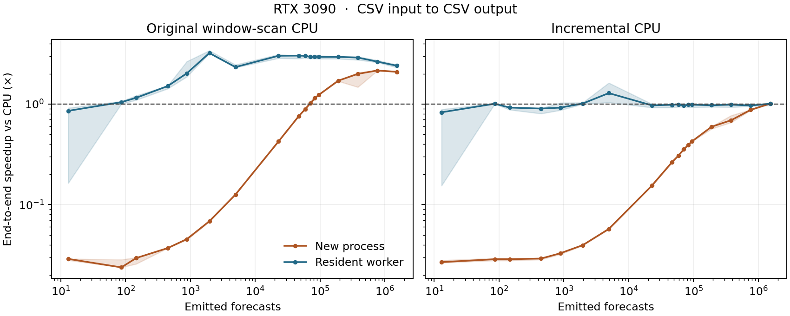

# 计算节点 端到端交叉点

同一份原始 CSV 连续回放到结果 CSV。冷启动时，SIMT、CUDA C++ 分块 Tile 和提前编译的 Triton Tile 均在约 **8.3 万行因子输出**这一档稳定超过原来的逐窗口扫描 CPU。与增量 CPU 比较，测试上限 **3,628,819 个逐笔事件、1,530,669 行因子输出**以内未找到可复现的持续优势。

## 多大开始比原扫描 CPU 快

以下“稳定”使用配对轮次的判据。对每个规模，计算每轮 CPU 耗时除以 GPU 耗时。要求其中位数至少为 1.05，且至少 70% 的轮次由 GPU 胜出。从所列档位至该次扫描的最后一档均须满足。结果是实测档位，行情分布和节点负载会影响边界。

| 运行方式与实验 | CUDA C++ SIMT | CUDA C++ 分块 Tile | Triton Tile |
| --- | ---: | ---: | ---: |
| 冷启动，种子 8001，每档 7 轮 | 82,837 行 | 82,837 行 | 82,837 行 |
| 冷启动，种子 42，每档 5 轮 | 82,714 行 | 82,714 行 | 82,714 行 |
| 常驻小规模细扫，种子 8001，每档 21 轮 | 1,959 行 | 1,539 行 | 部分较大档位胜出轮数不足 |
| 常驻小规模细扫，种子 42，每档 21 轮 | 4,975 行 | 93 行 | 4,975 行 |

冷启动在约 5.9 万行时，原扫描 CPU 更快。在约 7.1 万行时，两者相近。达到稳定优势的两个行情前缀都是 114,688 笔委托，对应 198,400 至 198,523 个逐笔事件。

常驻细扫中，两组行情在 **54 和 57 行**时，三种 GPU 的耗时中位数已略低于原扫描 CPU。此时差距只有约 0.1 毫秒，小文件容易受共享服务器调度和文件系统影响。在 21 轮细扫覆盖的区间内（最高约 1.1 万输出行），两个种子都达到上述连续胜率判据的保守档位，SIMT 约为 **5,000 行**，CUDA C++ Tile 约为 **1,600 行**。宽范围主测的 7 轮结果在 146 行就出现连续优势；种子 42 的宽范围 5 轮复核也出现过中间档位回落，因此应结合重复轮次理解小文件的阈值。

[主规模原始计时](stream-scale-rtx3090.json) · [第二个种子](stream-scale-seed42.json) · [常驻细扫 8001](stream-warm-seed8001.json) · [常驻细扫 42](stream-warm-seed42.json)

## 增量 CPU 对照

CPU 和 GPU 均使用相同的 C++ CSV 解析、委托成交校验及结果格式化。增量 CPU 在委托进入、滑出和成交时更新四个整数，每次输出仅需读取四个总量并求比率。GPU 还需传输变化量、分段扫描和返回结果。与原扫描 CPU 相比的提速包含主机算法及格式化的改进。

下表是主规模测试在最大档位的 7 轮中位数。单次冷启动包括进程退出，常驻请求从发送文件路径计时至结果文件关闭且收到回复。

| 实现 | 冷启动 | 常驻 |
| --- | ---: | ---: |
| 原扫描 CPU | 4,718.4 ms | 4,181.3 ms |
| 增量 CPU | 2,283.6 ms | 1,737.3 ms |
| CUDA C++ SIMT | 2,286.8 ms | 1,738.5 ms |
| CUDA C++ 分块 Tile | 2,309.3 ms | 1,809.9 ms |
| Triton Tile（AOT） | 2,293.6 ms | 1,724.5 ms |

Triton 在这档常驻回放的中位数比增量 CPU 低约 0.7%。在两个种子的宽范围测试中，三种 GPU 实现相对增量 CPU 均未达到连续优势判据。

横轴是实际输出行数，虚线表示与 CPU 耗时相等。每个点取三种 GPU 的配对加速比中位数，色带覆盖这三种实现的范围。左图采用原扫描 CPU，右图采用增量 CPU。

## 窗口打包、磁盘和初始化

- GPU 每批接收最多 8,192 个时点，每个时点包含四个 int64 值和一个行号，另有少量段偏移。每只证券每段的首行是该时点的绝对量，其余行仅传增减量。实际主机到 GPU 输入从每行 1,024 字节降至约 36 字节。输出仍按原始行情顺序写入最终 CSV。
- 旧流程先生成窗口文件及行键文件，再从 GPU 结果二进制文件重建 CSV。新流程在同一进程内用页锁定缓冲区传输，三份中间文件均已移除。
- 常驻进程在一次初始化中创建 CUDA 上下文、stream 和缓冲区。每个输入文件重建自己的委托状态。Triton 在构建时编译为 cubin，回放期间通过 CUDA Driver API 发射同一内核，消除了逐文件启动 Python 和加载框架的开销。

在 94,772 行的同一份输入上，对旧 SIMT 路径和新 SIMT 做了 5 轮专项测量。

| 指标 | 旧打包路径 | 新流式路径 |
| --- | ---: | ---: |
| 中间文件逻辑大小 | 101,670,383 字节 | 0 |
| 主机发送给 GPU 的字节 | 97,046,528 | 3,414,852 |
| 每个文件新建进程，CSV 到 CSV | 1,047.7 ms | 196.8 ms |
| 常驻进程，CSV 到 CSV | — | 117.0 ms |

旧流程“解析行情、构造窗口并写文件”耗时 559.5 ms。将相同两个输出指向 `/dev/null`，仍需 197.0 ms。旧 GPU 子进程耗时 161.1 ms，Python 合并结果耗时 333.8 ms。各列分别取中位数。新进程的 CUDA 初始化及缓冲分配中位数为 93.4 ms，常驻进程在处理后续文件时可以摊掉这项成本。专项测试和宽范围测试分别运行，绝对延迟会随节点负载变化。[开销拆分和每轮数据](stream-io-rtx3090.json)

## 测量条件与正确性

计算节点 使用 RTX 3090 24 GiB、驱动 550.76、CUDA Toolkit 11.3、Triton 3.2.0，主机为 Xeon Gold 6248R。测量程序和所有被测进程固定在靠近 GPU 的 NUMA 节点 0、逻辑核 6。主机代码使用 C++17 和 `-O3`。每个规模都从两只证券的模拟限价订单簿出发，依据价格与时间优先规则生成真实关联的买卖委托、部分成交及成交量。相同种子下用同一交易日行情的前缀改变规模。

每轮随机排列各实现的执行顺序。输入和最终输出都使用服务器工作目录中的普通文件，采用操作系统页缓存，以输出关闭为准。冷启动指新进程及新 CUDA 上下文，文件系统缓存正常保留。编译、生成数据和 SHA-256 校验位于计时区间之外。每次计时的结果 CSV 均与原扫描参考实现逐字节一致。

额外验证覆盖空输入、单侧委托、64 位求和、旧委托成交、8,191／8,192／8,193 行批次边界、146 只证券交错以及同一工作进程连续回放不同文件。三种 GPU 内核在 8,193 行跨批次输入上通过 Compute Sanitizer 显存检查。[回归检查](stream-checks.json) · [显存检查日志](stream-memcheck.txt)
